<!-- Animated panels: assets/*.svg are built by tools/build.py static; the live cards come from the `output` branch, refreshed daily by .github/workflows/profile.yml -->





  
  



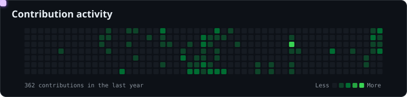


  
  <a href="https://portfolio-fares-ayman-1s-projects.vercel.app">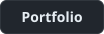</a>

